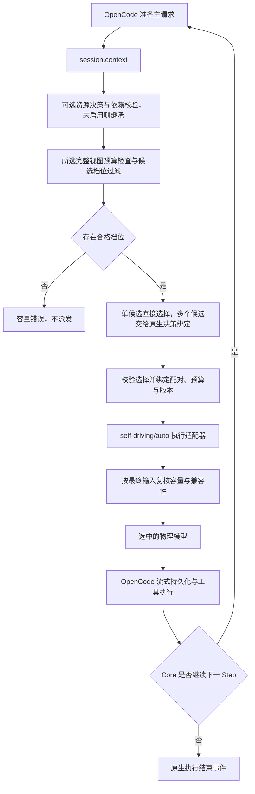

# opencode-self-driving

状态：**阶段 0 至 4 已完成本地验收；阶段 5 工具已实现、真实 OpenRouter smoke 部分通过，见 docs/validation/openrouter-live.md；阶段 6 TUI 与交付已实现、本地验收记录见 docs/archive/phase-6-validation.md**。当前包 `0.6.0-dev.0`。严格使用现有公开插件 API；stateful observer 与插件恢复继续 defer。

## 目的与已确认边界

`opencode-self-driving` 为 OpenCode 已准备执行的模型调用选择编码模型与 reasoning effort，并提供显式启用的上下文选择和自动工具审批策略。OpenCode 继续负责 Session、历史、工具执行、后续 Step、compaction、重试和执行结束判断。

用户已确认的约束：**严格只使用现有公开插件 API，不修改 OpenCode Core、Server、Protocol 或生成客户端，不要求新增 hook。**

为满足这一约束，插件注册组合模型 `self-driving/auto`，并通过公开的 AI SDK hooks 提供执行适配器。Core 始终解析并记录这个组合模型；实际物理模型由适配器在每次调用时选择和执行。

本文中“五档”指插件的策略档位 `low / medium / high / xhigh / max`。档位映射到完整的物理模型与 effort 配对，不要求档位名等于物理模型的 effort 名。

已确认的容量设计：**组合模型声明经过校验的最大可承接窗口，每次请求先按容量过滤候选档位，再进行路由；保留 Core 原生压缩。** 小窗口后端不拉低整个组合模型的窗口。插件不关闭 Location 自动压缩，不以未知窗口代替容量声明，不新增摘要存储、空 Step 或 synthetic 继续输入。

“最大窗口＋候选过滤＋长上下文压缩”已完成本地 fixture 专项验证，包括真实 SDK 宿主、原生摘要请求与 overflow 重建。真实 tokenizer、大窗口及模型质量仍待后续验收；OpenRouter 的短输入 / key 接入实测另见 docs/validation/openrouter-live.md；fixture 通过不等于生产可用。结果见 [docs/archive/phase-0-validation.md](archive/phase-0-validation.md)。

已确认的首版范围：**上下文选择与自动工具审批纳入设计；stateful observer 和插件恢复后置；只复用原生服务与凭证方式，不新增供应商适配。**

已确认的决策策略：**选模使用 Choice，不设通用 confidence 门槛；资源省略与自动审批分别使用 Boolean 概率和独立阈值；选模与资源选择采用确定性的有界证据投影，审批保留完整的必要授权、限制与执行参数。** 单个容量合格档位直接绑定；主请求准备共用总 deadline，审批另设 deadline，接入实际取消。具体阈值、投影预算与超时数值留待实现和实测验收，不把 Pi 的常量直接设为默认值。

设计依据见 [docs/research/decisions.md](research/decisions.md)。以上是用户已确认的设计决策，不是已完成的运行验证。

## 状态与证据

真实编码任务对照尚未通过完整质量验收，当前配置弱于固定 Mini；本轮修复了多段纯文本工具结果的 bridge 缺口。首次对照与修复后诊断分开记录，见 [编码任务报告](validation/coding-task-live.md)。

| 项目                                     | 状态                  | 边界                                                                                      |
| ---------------------------------------- | --------------------- | ----------------------------------------------------------------------------------------- |
| 纯公开 API 的组合模型接入                | 已验证                | 本地 fixture，真实 SDK 宿主与普通本地插件配置加载                                         |
| 五档、工具后的重新选模、流式输出         | 已验证                | 使用确定性物理模型 fixture，工具由 Core 实际执行                                          |
| 并发 Session 的请求绑定隔离              | 已验证                | 两个 Session，共享适配器                                                                  |
| 决策与后端取消                           | 已本地验收            | 资源 / 选模 / 审批、首包前 / 流中、host shutdown，真实 loopback HTTP                      |
| 无效选择和决策失败时阻断                 | 已验证                | 未调用物理后端，未隐式选择 fallback                                                       |
| 原生压缩与公开控制入口                   | 已验证部分路径        | 独立压缩调查，包含自定义结果、准入顺序和请求视图实验                                      |
| 最大可承接窗口、容量过滤与长上下文压缩   | 已验证本地 fixture    | 26 场景重复 10 轮；fixture 编码，不是实际后端容量验收                                     |
| 真实 Decisions、真实 provider 与凭证接入 | OpenRouter 部分已验证 | 原生 key / Jev 1.14 / GPT-4.1 Nano；文本断言一例失败，MCP 维持 ask 后续步成功；质量未验收 |
| 上下文选择与自动工具审批                 | 阶段 3 已实现本地验证 | opt-in 资源贡献；直接 MCP 审批；原生未知块 / CodeMode 整体保留                            |
| 分用途概率策略、有界证据与总 deadline    | 已本地验收            | Choice / Boolean、严格阈值、完整审批证据及实际 HTTP 取消；概率质量待阶段 5                |
| 正式包骨架与加载生命周期                 | 已本地验收            | 普通目录配置、离线安装产物、卸载 / reload、共享 Effect 与 import boundary                 |
| 五档配置、原生 HTTP 绑定与开关           | 已实现并本地验收      | 四种 Evaluation、OpenAI Chat / OpenRouter、key / env；无真实服务资格声明                  |
| 原生 retry 与生命周期释放                | 已本地验收            | Core retry 重建重新决策、并发、迟到事件、排空与 scope cleanup；无插件恢复                 |
| TUI / 交付与插件恢复                     | TUI 已实现，恢复后置  | 隔离 V2 CLI/TUI 本地验证；全局旧客户端不兼容，尚未发布，不承诺 exactly-once               |

### 早期可行性验证基线（历史）

以下数量来自阶段 0 / 0.1。当前检查和真实任务结果见 [验证总览](validation/README.md)。

- 最初原型基线为 OpenCode `60a5a6ca7ce176b04cd2321ffd1819b1ea8e6006`，包版本为 `2.0.32`。阶段 0 / 0.1 已将独立 worktree 快进到 `origin/dev` 的 `501b15af26915ba52682e20e220e7e137e89e92f` 并复跑；主目录未修改宿主代码。
- Bun `1.4.2`，macOS。Bun `1.3.5` 的普通目录插件加载曾在探测缺失的可选 `tui` 入口时失败；使用仓库指定版本后通过，没有修改宿主。
- 10 个验证用例、40 个断言全部通过；根目录 `bun run check` 通过，34 项 typecheck 成功，lint 为零错误、1,306 条既有 warning。
- 对插件及 provider fixture 入口的 bundle 导入图检查得到 110 个 runtime inputs，没有 Core、Server 或 SDK 实现目录。
- 独立压缩调查覆盖 14 个场景，随机顺序重复 10 轮：140 次通过、580 条断言。它证明公开控制路径，不证明本版最大窗口策略或真实模型摘要质量。
- 本轮在新基线上重跑阶段 0：10 个路由用例 / 40 条断言，以及 14 个独立压缩调查用例 / 58 条断言全部通过。
- 阶段 0.1 新增容量策略、公开插件与集成验证：26 个场景随机顺序重复 10 轮，260 次通过、1,310 条断言。覆盖联合窗口、候选过滤、发送前复核、原生阈值、摘要 / title / generate、overflow、工具续步、配置 reload 和并发。
- 新容量插件的 runtime 审计为 98 个 inputs，无 Core / Server / SDK 实现依赖，Effect external。SDK `bun typecheck` 与根目录 `bun run check` 通过；34 项 typecheck、0 lint errors、1,306 条既有 warning。新证据与复现入口见阶段报告。

本地证据：验证报告（本地验证材料：`packages/sdk/verification/self-driving/README.md`，未入库）、原型（本地验证材料：`packages/sdk/verification/self-driving/plugin.ts`，未入库）、测试结果（本地验证材料：`packages/sdk/verification/self-driving/results.xml`，未入库）。这些路径是本机 review 材料，不是未来发布包的依赖。

当前正式源码、配置方法与证据见 [README.md](configuration.md) 和 [docs/archive/phase-4-validation.md](archive/phase-4-validation.md)；历史结果见各阶段报告。阶段 2 起从已有公开 `@opencode/ai` 与 `@ai-sdk/provider` 打包原生绑定及跨包错误类型，`@opencode/plugin`、`effect` 与公开 Effect 子路径保持 external；没有 Core、Server 或 SDK runtime 导入。

阶段 5 的开发验收入口与证据分别见 [docs/qualification.md](qualification.md) 和 [docs/archive/phase-5-validation.md](archive/phase-5-validation.md)。通过公开 SDK 在临时宿主中加载正式插件；显式计划、预算、固定标签和 tuning / holdout 分离。所有实际模型转发共享请求、字节、输出和总时间上限；原生 Evaluation 无统一输出 token 参数，该上限不等同金额保证。报告区分 loopback / provider 请求、自动批准 / 测试 consumer 的 once 回复；无观察不补零，不根据连通性自动授予概率或编码质量资格。开发工具不进入插件 runtime bundle。

阶段 2 当前支持范围：决策沿用四种原生 selector；生成仅支持 OpenAI Chat / OpenRouter 的未压缩 JSON HTTP、文本 / reasoning 与本地函数工具。凭证仅活动 integration key 或显式 env 引用；OAuth / external 在解析前拒绝。Model / Provider / variant 的静态配置转交原生 factory，不声明复用了全部 Session HTTP hooks、WebSocket 或私有账户行为。编码使用 `utf8-bytes` 保守估算和显式余量，真实 tokenizer 校准未完成；不据目录窗口宣称端到端 1M 资格。

压缩的公开能力、实验方案与证据见 [docs/research/compaction.md](research/compaction.md)。其中自行压缩历史和未知窗口方案保留为调查记录，不属于当前 MVP。

原型中的固定回答、固定标题和仅保留 `proof_echo` 的工具过滤均属于 fixture，不能作为正式插件行为照搬。

## 与 pi-self-driving 的对应

| Pi 当前能力                             | OpenCode 方案                                                  | 差异                                                 |
| --------------------------------------- | -------------------------------------------------------------- | ---------------------------------------------------- |
| `self-driving/auto` 虚拟模型            | `provider.transform` 注册组合模型，AI SDK hooks 安装执行适配器 | Core 的持久化身份保持组合模型                        |
| Decisions 类型化问题与答案              | 复用原生 `@opencode/ai/experimental` Evaluation 绑定           | 四种现有入口分别验收，不新增 Pi alpha transport      |
| 五档模型 / effort                       | 五档映射到完整后端配对，先过滤本次容量不足的档位               | 合法选项是五档的非空子集，不能调用内部 Core resolver |
| 每个新逻辑请求取得准入，传输 retry 复用 | 每次主请求的 context 准备都取得新的本地绑定                    | 当前 hook 不提供稳定的逻辑请求 ID，不能声称重试等价  |
| 可选上下文贡献选择                      | 首版设计来源可验证的原生与插件资源选择，必需指令保留           | 缺少统一来源快照；CodeMode 内部目录作为整体保留      |
| 独立自动工具审批                        | 首版设计公开 tool / permission hooks 接入                      | 显式开启，只处理 ask；证据不足时维持原生人工审批     |
| Entry observer                          | 第一版不提供 stateful observer                                 | 实时事件订阅不等于 durable log 重放能力              |
| 独立 Durable driver                     | 不移植                                                         | 使用 OpenCode 原有执行与恢复边界                     |

这里的 Step 遵循 OpenCode 术语：一个逻辑模型调用可能包含多个物理尝试。插件不把一次调用称为 Turn，也不引入自己的 agent loop。

## 第一版范围

第一版设计包含：

1. 可安装的 server plugin 与 `self-driving/auto` provider adapter。
2. stateless 五档选择；每档由用户配置一个支持的模型 / effort 配对。
3. 复用现有原生决策与后端绑定，按服务、模型、凭证方式分别验收；不额外新增供应商协议或登录流程。
4. 配置、启用、关闭、状态查看；TUI 通过公开 RPC 接入 server plugin。
5. 主请求路由，以及 title、compaction、generate 的明确辅助请求策略。
6. 请求级绑定、后端取消、错误报告和插件自己的路由用量记录。
7. 有限且真实的最大可承接窗口、逐请求容量过滤、发送前复核，以及原生压缩兼容。
8. stateless 上下文选择：按请求重建资源视图，保留必需内容，省略来源与依赖可验证的可选单位。
9. 独立自动审批：原生权限 ask 上的可选策略，逐工具声明证据范围；提供关闭、shadow、auto 三种模式。

第一版不包含自动续工或目标验收、子 Session 调度、工具执行循环、stateful observer、插件跨进程准入 / 决策恢复、CodeMode 内部目录裁剪、自有历史摘要与 checkpoint 调度器。

默认继承宿主上下文，自动审批关闭；用户分别启用资源选择与审批。二者纳入首版设计与验收，不成为启用模型路由的隐含前提。关闭审批不改变原生 allow / ask / deny。

最大窗口、容量过滤、资源 / 审批、原生接入以及 R4 / R6 策略方向已确认；具体绑定支持集、数值预算与其余配置提案仍待 review / 验收。

## 架构与所有权



| 所有者        | 职责                                                                                          |
| ------------- | --------------------------------------------------------------------------------------------- |
| OpenCode      | 输入准入与投递、Session 历史、工具与权限、compaction、Step 与 retry、进程内执行协调、原生恢复 |
| server plugin | 配置、模型目录贡献、资源 / 选模 / 审批策略、调用绑定、原生绑定桥接、诊断、取消补偿            |
| TUI plugin    | 配置表单、启用 / 关闭入口、实际模型与档位展示、错误与状态展示                                 |
| 原生决策绑定  | 使用现有 Evaluation provider 回答类型化问题；执行策略校验并上报自身用量                       |
| 原生后端绑定  | 复用公开 provider 构造模型，桥接 effort、消息、工具、流与取消，不新增供应商协议               |

server plugin 是配置与路由状态的唯一写入边界。TUI 不另外运行分类器或维护一份配置真相。共享的 language adapter 在初始化时安装，具体模型选择保存在调用 options 中，不能保存在单个全局 `currentModel` 变量中。

Core 在主请求 context hook 之前按组合模型已声明的容量判断自动压缩。插件负责物理配对的容量准入；原生摘要、近期历史保留、checkpoint、overflow 补救和恢复继续由 Core 管理。

### 公开 API 使用

| 用途               | 现有入口                                                                     |
| ------------------ | ---------------------------------------------------------------------------- |
| 插件定义与生命周期 | `Plugin.define({ id, setup })`，setup 返回 cleanup                           |
| 模型目录           | `ctx.provider.transform`；必要时使用 provider / model reload                 |
| 执行适配器         | `ctx.aisdk.hook("sdk")` / `ctx.aisdk.hook("language")`                       |
| 主请求与辅助请求   | `ctx.session.hook("context" / "title" / "compaction" / "generate")`          |
| Session 模型选择   | `ctx.session.get`、`switchModel`、`wait`                                     |
| 配置存储与命令     | `ctx.storage`、`ctx.command.transform`                                       |
| 生命周期通知       | `ctx.event.subscribe`                                                        |
| UI 通信            | `ctx.rpc` 与公开 TUI API                                                     |
| 支持范围内的凭证   | `ctx.integration.connection.active / resolve`                                |
| 资源与审批         | 公开 skill / tool / MCP 元数据、`tool.execute.before`、`permission.evaluate` |

禁止导入 Core 或 Server 的运行时模块、直接读取宿主数据库、调用未公开的 resolver、patch 宿主对象、借助内部测试 layer 获得运行能力。SDK 仅用于开发验证宿主，不能进入插件 runtime graph。

原生 Evaluation 入口为 TypeSafeAI、OpenCode、OpenRouter、VercelAIGateway。生成使用已有原生 provider 与已配置连接。插件没有公开的任意 Model.Ref 流式 resolver；原生目录中的模型不自动成为组合模型可执行后端。只展示公开入口、settings、凭证行为与流桥接均已验收的绑定；不为补齐支持率复制私有 resolver。详见调查报告的服务 / 凭证清单。

## 选择与请求绑定

### 配置配对

以下类型描述插件自己的拟议契约，不是新增的 OpenCode API：

```ts
type Tier = "low" | "medium" | "high" | "xhigh" | "max"

type CodingPair = {
  backend: string
  model: string
  effort?: string
}

type RouteBinding = {
  id: string
  sessionID: string
  configRevision: string
  capacityRevision: string
  viewRevision: string
  evidenceRevision: string
  pair: CodingPair
  outputBudget: number
} & (
  | { source: "primary"; tier: Tier; eligibleTiers: Tier[]; selection: "decision" | "capacity" }
  | { source: "title" | "compaction" | "generate" }
)
```

同一配对可供多个档位使用。保存配置时检查适配器支持范围、模型可用性与合法 effort；分派前再次检查实际后端是否仍可用。未知后端、缺失凭证或不支持的 effort 必须明确失败。

容量依据包括输入上限、总窗口、输出上限、编码开销和必要余量。未确认的物理上限不能被当作无限，未验收的后端不能用来扩大组合模型声明。每次容量目录变更产生独立的 `capacityRevision`，用于关联窗口声明、候选过滤和最终派发检查。

`backend` 引用已验收的原生后端绑定，物理 effort 由该绑定映射。不能假设所有 provider 都接受同名 `reasoningEffort`，也不能因为 Core 的组合模型存在某个 variant，就认为物理后端支持该 effort。

### 决策过程

1. 仅在模型为 `self-driving/auto` 的主请求 context hook 中执行主路由。
2. 构造资源快照；启用上下文选择时先完成可选单位决策、依赖闭包与原子视图校验。对所选 system、完整 messages、tools、输出与 reasoning 预留构造预算，按后端限制得到 `eligibleTiers`。
3. 候选为空则报告容量错误，不调用选模决策或生成后端，不静默裁剪原生历史，不在 hook 内安排额外压缩控制项。此前可选资源决策的已发生用量照实记录。
4. 只有一个合格档位时直接选择，标记 `selection: "capacity"`；多个合格档位时，从本次可见上下文与合格配对构造 stateless 有界决策证据，保持所保留用户、assistant、工具结果的角色和关联。
5. 存在多个合格档位时，原生决策绑定回答 `route` 类型化 choice 问题，合法选项只能是 `eligibleTiers`。容量不足的档位即使配置有效，也不能参与本次选择。
6. 分类答案必须属于本次候选集合，并标记 `selection: "decision"`；两种选择路径都将档位转换为完整配对，绑定配置、容量版本与输出预算。
7. 通过本次请求 options 携带绑定，并设置本次输出预算；执行适配器按最终输入复核，仅发送一个物理模型调用。
8. 物理输出交还 Core，后续工具与 Step 由 Core 决定。

单候选直接选择已确认：没有可比较的档位时省去分类调用，明确记录决策模型未调用，不伪造分类答案或 provider 用量。它不是请求失败后的 fallback，也不允许多个合格档位时擅自跳过分类。

绑定 ID 是插件本次准备的关联 ID，不是宿主 Step ID、逻辑请求 ID或服务端幂等键。首版不使用历史 hash 假装恢复这些身份。

每次 context 准备重新决策，包括宿主可能进行的重试或重建。插件不添加隐式决策重试、生成 fallback 或模型失败后私自换档。宿主已有 retry 仍由 Core 管理，所以一次 Step 可能产生多次决策费用。

主请求准备使用包含资源选择、容量过滤与选模的总 deadline；各阶段共用剩余时间，不能分别重置超时。10 秒只是待测起点，审批另设预算。使用公开 Effect timeout / interruption 与本次取消信号，不能只做 Promise.race。当前 Evaluation route 未使用生成 transport 的 timeout 包装，仅填写 http.timeout 不能证明生效。

选模决策失败、超时、取消或非法答案阻断派发；资源决策失败则保留原生完整视图并重新算容量，若仍需选模却无剩余时间则阻断；审批失败保留原生 ask。没有隐式决策重试或跨模型 fallback。

编码预算与决策输入预算分别校验，包括每请求 / 每问题 tokens、UTF-8 请求体、questions / criteria 与模态。首版不使用固定 64 KB 默认，也不通过静默截断证据宣称长上下文能力。TypeSafe 文档当前默认是每请求 64K / 每问题 32K tokens，显式长上下文为两者 262K；其他原生入口分别核实，不能据 HTTP body 上限推导窗口。

选模 / 资源选择采用确定性的有界投影，按下述证据契约保留必需字段、完整交互单位、遗漏清单和版本，单独验收质量；不改写生成历史。`full` 保留为完整可见请求的对照模式，支持范围受实际决策容量约束，不作为有界投影失败后的隐式切换。审批不得通过丢掉授权、限制或精确参数来扩大自动放行范围。stateful observer 与自有摘要本轮不实现。

`Evaluation.run({ model, state, questions })` 承担类型化分类。绑定记录服务、请求模型、可验证的响应身份与连接引用；对原生 route 回填的身份不声称独立验证。Pi alpha Decisions transport 不新增到本插件。

按用途区分策略：选模只强制合法候选及原生契约需要的分布，不设跨服务通用 confidence 门槛；资源选择使用 `p(needed)`，仅低于专用省略阈值时省略；审批使用 `p(needs_human)`，仅低于专用审批阈值时考虑 ask→allow。confidence 缺失不补造；Boolean 原生没有该字段。

完整分布如需检查，必须考虑服务声明的舍入精度，不照抄固定 `.01` 求和容差。confidence 是概率的派生统计量，不是正确率保证；候选数随容量变化也会影响其数值。阈值、模型、问题和证据版本一起验收。R4 的解释与示例见调查报告。

### 决策策略与证据契约（已确认）

| 用途     | 输出与判定                                                                                              | 证据或决策不可用时                                       |
| -------- | ------------------------------------------------------------------------------------------------------- | -------------------------------------------------------- |
| 选模     | Choice 必须属于 `eligibleTiers`；遵循原生概率分布契约；有 confidence 则记录，不用统一门槛拒绝或自动升档 | 需要选模却无法构造证据、超时或答案非法时阻断派发         |
| 可选资源 | Boolean `needed`；只有 `p(needed) < tau_omit` 且依赖闭包成立才省略；required 不进入判断                 | 保留原生完整资源视图，重新检查容量，不提交部分裁剪       |
| 自动审批 | Boolean `needs_human`；完整必要证据与原生 ask 同时满足后，只有 `p < tau_allow` 才允许 ask→allow         | 等于阈值、缺字段、超限、超时或无法核对实际参数时维持 ask |

`tau_omit` 与 `tau_allow` 分别配置、校验与验收，不共享一个全局 confidence。未配置有效阈值时不能启用对应的资源省略或 auto 审批；shadow 可以收集有效概率，但不改变原生审批。完整分布按原生契约保留；不填造缺失概率、不静默归一化。选模保持 Choice，不把 Score 的小数或期望值四舍五入成档位。

有界证据投影是从本次公开视图重新构造的结构化 JSON，不额外调用摘要模型，不保存第二份 transcript。投影与问题均带版本，固定输入、配置和预算下的保留顺序可重现：

| 证据部分       | 保留规则                                                                                                                                  |
| -------------- | ----------------------------------------------------------------------------------------------------------------------------------------- |
| 当前任务与约束 | 完整保留可确认的当前用户任务 / steering，以及策略要求的适用指令与用户约束；不能通过截断这些内容满足预算，也不声称恢复了已不可见的原始授权 |
| 近期任务历史   | 在剩余预算内按时间从近到远选择完整 exchange；保留原始顺序、角色、tool-call/result 关联，不截断单条参数、结果或成对关系                    |
| 决策目录       | 选模包含全部本次合格档位及能力说明；资源选择包含本批可选单位的 ID、版本、描述、required 与依赖；容量计算由代码完成                        |
| 投影说明       | 记录 schema / policy 版本、来源视图版本、实际大小、保留范围与省略清单，区分原生压缩已经不可见和本次投影主动省略的内容                     |

可选历史单位无法装入剩余预算时，整体省略并记入清单，不截断其内容或工具关联。必需字段或不可省略的完整单位无法装入总预算时，按上表执行选模阻断、资源完整保留或审批 ask。依赖的原始用户约束不再可取得时，不以投影指纹或较早诊断记录代替。投影可能漏掉影响难度或资源相关性的旧事实，验收必须比较其完成质量与错误省略，不能宣称无损。

审批使用独立证据构造，保留当前判断所需的用户授权、限制、适用指令、原生 action/resources/source、精确参数 / diff 与 cwd；不沿用选模的有损历史投影。证据不完整时保留 ask，不能以低概率覆盖证据缺口。

生成后端容量检查始终覆盖实际发送的完整所选视图；不能用较小的决策投影计算编码预算。状态分别展示编码可承接范围、决策输入范围与审批支持范围；只有一个合格档位时可跳过选模决策，其他需要决策的阶段仍单独遵守输入限制。

总 deadline、实际取消、无隐式重试与三种失败行为已经确认。`10s / 5s`、`tau_omit / tau_allow`、投影 tokens / bytes / 近期交互预算、物理输出预算及 tokenizer 余量尚未设为正式默认值；按原生绑定与代表性输入实测后确定。模型版本、问题、证据投影和阈值作为同一配置验收，任何变化都重新检查适用范围。

### 与其他插件的关系

hooks 按宿主顺序执行，后续插件仍可改变消息、工具或 options。首版分类依据是本插件 context hook 观察到的快照，不承诺它等于最终 provider payload，也不冻结其他插件的对象。

本插件拥有的绑定缺失、格式错误或指向不支持的配对时，适配器拒绝发送。后端绑定按实际序列化的最终 system、messages、工具声明、输出预算与必要余量检查所选物理模型。后续 hook 增大输入、提高输出预算或改变模态导致所选配对不再合格时，本次请求失败，不在适配器中偷偷重选模型。完整的“分类快照等于发送快照”约束不在已验证能力内。

阶段 0.1 发现：从适配器抛普通 Error 会被 Core 归为未知 provider 错误并重试。插件拥有的绑定 / 容量拒绝必须使用公开 AI 包的非重试请求错误，并与真实 provider overflow 区分；已用 `AIError` + `InvalidRequestError` 验证终止且不出现 `session.retry.scheduled`，不修改 Core 的 retry 策略。

## 组合模型的能力、历史与费用

Core 在 hook 前已经解析模型。`session.context.model` 是只读的；`switchModel()` 更新 Session 后续选择，不能替换已经解析的当前请求。

### 最大可承接窗口

组合模型的容量描述整个路由系统能够服务的请求范围，不要求所有成员模型都能处理每一种已准入请求。每种已声明可承接的预算必须至少有一个受支持配对能够处理，且路由必须遵守本次容量过滤结果。

- `auto` 的 input/context 使用经过验收的最大可承接范围，不取模型池最小窗口，不填未知的 0，也不声明虚假的巨大窗口。
- 首版建议采用明确、有限的统一输出预算；具体数值待 review，必须与 reasoning 计费方式及所启用配对的输出能力兼容。
- 按该输出预算和后端开销计算可承接输入，选择能够支撑最大输入的配对作为容量声明依据。input、context、output 必须来自一个可满足的联合预算，不能分别取不同模型的最大值后拼接。
- 模态和工具能力仍限于首版已验收的共同范围。扩大输入容量不表示把其他能力一并取并集。
- Core 的 token 估算不等于物理后端 tokenizer 结果。准入需要预留误差空间，派发前还要按所选后端复核；不得声称估算等于精确 token 计数。
- 决策输入策略、压缩模型和相关入口都必须能承接所声明的范围。若其他环节无法支持，不能仅凭编码模型的 1M 目录值对外宣称端到端 1M 能力。

以下仅示意容量过滤，数字假定已经计入输出和必要余量：

| 请求预算 | 可选后端窗口   |
| -------- | -------------- |
| 80K      | 128K、256K、1M |
| 200K     | 256K、1M       |
| 500K     | 1M             |

随着历史增长，小窗口后端可能不再参与路由，即使任务难度较低。插件接受这一约束，不为重新启用小窗口后端而提前压缩全局历史。容量与任务难度分别记录，不能把“只有大窗口档位可选”报告成“任务必然复杂”。

### 原生压缩

保留宿主原生自动压缩设置。Core 依据 `auto` 声明的有限容量及宿主 buffer 计算阈值，仍会在上限前预留空间；最大窗口方案不承诺用满物理模型的全部目录容量。

正常路径不因池中某个小窗口后端的限制提前压缩，而是把该配对排除出本次候选。插件不维护第二份 transcript、持久化摘要或 checkpoint，不通过空 Step、synthetic 继续输入或中断恢复来安排压缩。

provider 因估算偏差拒绝输入时，保留 Core 既有的 overflow 压缩与重建策略；插件不在适配器中另加重新压缩和重发循环。这类补救仍可能早于声明阈值发生，应记录实际原因，不能承诺任何错误下都不提前压缩。重建请求重新执行容量过滤与分类，沿用前述重试边界。

### 模型池与容量版本

保存模型池时同时验证容量声明、合格档位计算、统一输出预算、分类输入支持与辅助配对。添加小窗口后端不得自动降低已有的大窗口声明；移除或缩小承担最大容量的后端时，必须显式重新计算能力并展示影响。

同一 Location 中共享 `self-driving/auto` 的 Session 必须共享同一活动配置与容量声明。首版建议只激活一个 profile；并发使用不同容量的 profile 需要不同 Model.Ref，留待单独设计，不能用逐 Session 修改共享 catalog 的方式模拟。

首版建议在受影响的 self-driving Session idle 后应用配置及公开 model/provider reload。现有绑定保留创建时的配置和容量依据，不能被新的配置替换；发送时若无法兑现已绑定配对则明确失败。不得混用旧窗口声明与新候选集合继续生成。

阶段 4 已实现：控制操作串行化，publish 遍历公开 Session 分页、等待相关执行 idle，并排空后台 title / 独立 generate 等插件工作。期间已有执行继续使用旧快照；新执行在决策 / 生成前拒绝，更新后由调用方重试。不是新建输入队列，Core 已准入的输入和历史不被删除。提交前重新核实容量，刷新后核对公开 auto model 的 input / context / output，再写 published storage。失败恢复旧 profile 与目录；恢复失败时停止新调用并要求 reload。

RPC 在排空阶段取消会保留旧 profile，且不隐式 interrupt 正在运行的模型。进入提交后不能承诺撤销，调用方需读取 config / status。公开 API 没有 Session admission / catalog / storage 的联合事务，本版不声称跨这些边界原子发布。

首版建议仅支持可完整重放的文本和工具历史。在 context hook 仍能观察原输入时拒绝不支持的模态，避免 Core 按组合模型能力降低输入后才发现内容缺失。不得把另一 provider 的签名 reasoning、opaque compaction 或 native continuation state直接跨模型复用。

原生历史中的模型身份保持 `self-driving/auto`。插件自己的状态区展示实际 adapter、model、effort、档位与绑定 ID，不伪造原生 Session model selected 事件。

Core 按组合模型 catalog 价格计算原生费用，无法自动按每次物理模型切换计价。首版需明确展示“组合模型估算”，并单独记录：

- 决策用量与生成用量。
- provider 报告费用与按目录价格计算的估算费用。
- 已知值与未知值；缺失数据不能补成零。

fixture 中未设置价格而得到的原生零费用不应成为产品默认值或节省成本的证据。

## 辅助请求

`session.context` 对应主请求。title、compaction 和 generate 必须分别处理，不能在缺少主请求绑定时悄悄回退到任意模型。

建议第一版为三类辅助请求配置固定配对，不运行五档分类；它们分别检查实际输入和输出预算，不要求短标题配对具备主请求的全部长上下文容量。

compaction 配对必须能够处理最大可承接窗口内的实际摘要输入，并为原生摘要指令、输出与必要余量留出空间。只有小窗口摘要模型的配置不能通过长窗口 profile 的验收；不能依赖 Core 为让摘要请求塞入小窗口而丢弃较早 exchange。普通文本摘要、近期历史保留和 checkpoint 仍由 Core 生成并持久化。

插件不通过改写 Location 级 compaction agent 来影响其他 Session。若宿主已经显式配置辅助模型，必须检查实际生效的配对和容量；不能静默覆盖或声称插件固定配对已经生效。不同辅助模型解析路径与 `auto` 适配器的配合列为专项验收。

没有 Session context 的全局生成请求若显式选择 `self-driving/auto`，首版应返回明确的不支持错误，直到该入口有独立的公开接入与验收。插件不修改 OpenCode 的全局默认模型来扩大覆盖范围。

原型固定返回标题只用于排除测试噪声，正式插件不得返回固定标题或绕过真实 compaction。

## 取消与生命周期

现有桥接仍没有可靠转交 `LanguageModelV3.doStream()` 的 AbortSignal，Promise context hook 也没有取消参数。阶段 4 用两个现有公开边界处理：主执行准备通过实时事件补偿，生成通过 Core 消费的流传递取消，不只依赖 doStream options。

1. 请求先发出本插件的公开 RPC `checkpoint`，等待同一进程事件队列处理到该事件，再建立本地执行关联。生命周期事件的 `durable.seq` 只过滤旧 / 重复事件；本地对象不是宿主 execution ID，不是新的执行 ownership。
2. 准备 deadline 从请求开始持续覆盖资源、容量、选模与绑定交接。未消费绑定同样到期释放，避免独立 Session.generate 在后续 hook 阻塞 / 取消后永久残留。Core 首次读取零缓冲流后结束准备计时，随后读取 / 取消直接到达真实 native HTTP。
3. 工作记录区分 preparing / pending / streaming / approval；正常完成、失败、中断、未消费到期或 cleanup 都释放记录。资源 / 审批视图按本次 Step 的 assistant message 关联，在工具结算后清理；终止事件按本地执行关联清理兜底，不按 Session ID 误杀新执行。
4. 后台 title 按 Core 原生生命周期可晚于前台 idle 完成；独立 generate 不等待前台结束事件。发布排空也包含这些工作。迟到的错误核对请求和执行关联后才记录，不覆盖后续执行。
5. 事件流结束或失败时停止接入并取消自身工作，不自动重连、重放或恢复。重新 load 只保留已发布配置、原模型与显式策略设置，新请求重新决定。
6. Core retry 重建 context 时重新分类、重新绑定；不保存传输 retry 的“逻辑请求身份”，不加插件重试。steer 仍按原生安全边界投递，不自动取消当前请求。

Location reload 可能等待旧执行释放宿主 scope 租约。需要立即停止时使用原生 Session interrupt；本地验证分别覆盖请求重载加原生中断、idle reload、host shutdown。不是“请求 reload 一定立即断开模型”的承诺。

取消表示本地信号和连接已尽力终止，不保证远端模型停止执行、外部工具撤销或账单停止。插件不新增一套执行 ownership、集群 claim 或恢复协议。

## 配置与用户体验

建议沿用 Pi 的显式启用方式：加载插件只注册能力；用户完成配置并对当前 Session 启用后，才选中 `self-driving/auto`。

已实现命令（另提供 `/self-driving on` 与 `/self-driving policies`）：

| 命令                   | 行为                                            |
| ---------------------- | ----------------------------------------------- |
| `/self-driving`        | 配置未完成时进入配置；完成后启用当前 Session    |
| `/self-driving config` | 编辑原生绑定、五档、预算、资源与审批策略        |
| `/self-driving status` | 显示窗口、选择、资源省略、审批模式与失败原因    |
| `/self-driving off`    | 停用本 Session 插件策略，恢复之前的完整模型选择 |

建议启用 / 关闭在 Session idle 后执行，不隐式调用 interrupt。若用户手动选择其他模型，后续请求不再进入本插件路由。关闭时原模型不可用则报告原因并保留用户选择权，不私自挑选另一个编码模型。

恢复的模型选择包含 variant。关闭操作同时停用该 Session 的资源选择和自动审批；配置仍保留供下次显式启用。

配置通过 server plugin 的公开 storage 保存，草稿与最后可用配置分开。阶段 2 采用每 Location 一个显式活动 profile，不做隐式全局 / 项目多层合并，供本轮 review。保存模型 / variant 的先前选择用于关闭 / reload，不恢复路由决策或执行。配置保存和发布遵循前述模型池与容量版本约束。

状态展示区分“配置中存在的档位”和“本次容量合格的档位”，并给出被排除的容量原因。显示的是组合模型声明的最大可承接范围，不暗示每个后端都支持该范围，也不把后端暂时不可用报告成上下文已经被压缩。

凭证通过支持范围内的公开 integration 接口解析，或由用户显式配置的环境变量提供。配置、RPC 响应和路由记录不得包含 credential 值；不读取宿主内部认证文件或数据库。

TUI 首次通过原生 prompt 导入完整 profile JSON；服务、凭证引用、预算、阈值使用完整 JSON 编辑，模型 / variant 使用公开原生目录选择器。保存草稿与确认发布分开；Home 可配置，启用与策略只作用于命令开始时选定的 Session。状态面板与底栏使用公开事件刷新。TUI 使用公开 keymap、dialog、slot 和 RPC。状态展示区分宿主 Session 状态与本次路由诊断。headless 必须能够使用已完成配置，缺配置时明确失败。首版不把 UI 是否连接推断为工具授权。

## 上下文选择与自动工具审批

### 上下文选择

第一版设计覆盖整个 Session 生命周期中的原生与插件资源，包括 MCP、skills、tools 和 AGENTS.md；不限定插件自己贡献的内容。`inherit` 保留原生完整视图；`select` 按请求选择可以可靠识别的可选单位。它管理每次请求中的资源视图，不接管 Core 的发现、加载、历史持久化或 compaction。

资源快照字段为 `id / version / kind / source / required / dependencies`；来自当前公开请求、工具目录与显式贡献映射，不建立第二份权威注册表。公开 context 没有统一 instruction source ID / hash，无法证明来源或完整边界时整体保留。

阶段 3 的实现选择供 review：`contextSelection: inherit / shadow / select`，profile 配置 `resources.tauOmit`。其他插件通过已有 `SystemPart.metadata["self-driving/resource"]` 声明完整单位，字段为 `id / kind / source / required / dependencies / tools`，内容版本由本次实际 block / tool 定义计算。它是本插件定义的 opt-in metadata 契约，不声称为宿主原生来源字段；贡献者负责声明准确的边界与依赖。`instruction` 不带工具；`tool-bundle` 只接受本次目录中无 namespace、`codemode: false` 的直接工具，且不能包含 skill / execute。基础 system 前两个位置和未经标注的内容保留。原生 AGENTS、skill、MCP 尚无可靠细粒度贡献映射，因此保持整体；没有实现通用 native 资源裁剪。

本次资源结果记录贡献 manifest、内容版本、原始视图 hash、各概率和 proposed / omitted。`shadow` 计算闭包与提案，保留实际原生视图。重复 ID、工具重叠、缺失依赖或无效批次均整批回退；下游 hook 恢复被省略工具会在物理派发前失败。

1. 基础 system、agent 指令、适用 AGENTS.md、用户明确调用的 skill、必需依赖、已经加载进对话的正文、未知来源块均保留；不按段落猜测删除，不裁剪原生对话或破坏工具关联。
2. 对可选资源提交 `needed` Boolean 问题；无问题时跳过 Evaluation。只在低于经 review 的 `tau_omit` 且依赖闭包成立时省略，临界或不确定时保留。
3. 完整校验本批答案和依赖后，得到临时资源视图，再计算容量与选模；最后提交所选视图及请求绑定。部分失败不提交半份裁剪结果；回到原生完整视图，重新算容量。
4. 每 Step 重新观察，包括 skill / 嵌套指令加载、MCP 变化、压缩、fork / revert 之后。只保留进程内请求快照和必要关联；不恢复旧分配、不维护 observer cursor。
5. 可选资源决策与选模最多形成两个串行阶段，共用总 deadline。联合问卷中的独立答案不能替代依赖与容量计算；无资源问题、单候选时分别跳过对应阶段。

直接工具声明可从本次 context 中移除，在公开 `tool.execute.before` 中核对可关联的选择；skill 名单选择也需与实际 skill 调用保持一致。选择不授予新权限，其他原生权限照常执行。

CodeMode 的内部 catalog 在 context hook 前已经构造；首版把 `execute`、内部目录与不能拆分的相关说明整体保留。不能声称已隐藏单个叶子工具的搜索结果，也不重建私有执行器。对 MCP server 指令与工具、skill 目录与正文无法可靠建立依赖时，作为整体保留。不能反复修改 Location 级 transform 为单个 Session 选择资源；也不默认切换 Location 的 CodeMode 设置。

没有可靠来源或请求关联时，使用完整原生视图或明确报告该选择模式不支持，不承诺无法执行的门禁。阶段 3 已本地验证 opt-in 来源、动态更新、依赖闭包、下游改写与执行门禁；通用 native 来源适配与完整生命周期竞争仍不在已验收集合。

### 自动工具审批

审批独立于选模和资源选择，模式为 `off / shadow / auto`，默认 off。shadow 记录概率与拟议动作，仍由原生 ask 等待人工；auto 只对显式启用的 Session、支持的 action / 工具证据类型生效。加载插件或选择 auto 模型不隐含开启审批。先用 shadow 评估代表性数据上的错误与覆盖率，auto 的支持声明以对应工具和凭证验收为准。

1. 在原生 `permission.evaluate` 边界处理 `effect: ask`；原生 allow 不重复审批，配置 deny 在 hook 前返回且保持权威。不绕过 `permission.assert` 或写宽泛 allow 规则。
2. 证据包含公开可取得的用户授权与约束、适用指令、cwd、tool/source、原生 action/resources、精确执行参数或变更。assistant、工具输出与描述是事实，不新增用户授权；不能只问“是否可逆”就自动批准。
3. `tool.execute.before` 的克隆快照只作补充。后续 hook 可能改写参数，优先使用原生 permission metadata；MCP 当前带 `metadata.input`，shell 当前未附完整 command。不能核对关键实际参数或原始授权时维持 ask，不宣称覆盖所有工具。
4. Boolean 问题为 `needs_human`，只有证据完整、原生规则允许进入 ask、概率严格低于专用 `tau_allow` 时才设置 allow。阈值相等、未知 action、输入超限、超时、取消、缺字段、证据不匹配均保留 ask。不得把 Pi 的 `.05` 当作已校准错误上界。
5. 一次结论只对应当前 source/call、action/resources 与证据版本；不复用成整个 Session 或整个工具的批准。不冻结宿主参数对象，不跨进程恢复待审批结果。

审批不通过丢弃参数、用户限制或自动摘要来适配决策窗口。原生压缩后公开视图不足以证明授权时，自动覆盖率下降并回到人工。工具没有调用原生权限检查时，此策略不会自动覆盖它；其他插件仍可能改变权限结论，不声称为可隔离恶意插件的安全边界。

阶段 3 实际支持集：profile 显式配置 `approval: { tauAllow, timeoutMs, maxBytes, maxTokens, mcpServers }`，Session 再通过 `policies` RPC 显式启用 `off / shadow / auto`。资源策略与审批同样绑定当前 profile revision；重新发布需再次启用，reload 只保留配置开关，不恢复批准或分配。关闭同时停用两项策略。

自动审批当前只接受 `codemode: false` 的直接 MCP 工具：公开 namespace 必须唯一对应已连接、已列入配置的 server，action 与工具 ID 一致，resources 为该原生绑定的 `["*"]`，`metadata.input`、tool before 克隆、原生 running invocation 精确一致。用公开 Session context 的消息前缀和 source 关联本次生成绑定，同时纳入原始完整视图、最终实际请求、cwd 与完整原生可见历史。没有本插件的当前生成绑定、CodeMode 叶子调用、未知 action、shell、参数变更或证据超预算均 ask。当前只要可见 context 中出现 compaction 就保守 ask，不尝试恢复之前授权；覆盖率与更细判定留待后续 review / 真实验收。

公开 server 插件没有统一 `hasUI` 判断；原生 ask 可能等待客户端，headless 不声称一定自动阻断。状态显示 `manual required` 原因，原生批准 / 拒绝仍走宿主 UI / API。

## 后置：Stateful observer 与插件恢复

不维护第二份 Session transcript 或 workflow 数据库。现有实时事件订阅没有 durable replay 保证，且插件 context 未直接暴露 Session log。第一版不承诺 Entry 同步、stateful 决策、准入恢复或 exactly-once 生成 / 计费。

这些能力若以后实现，仍受“仅现有公开 API”约束，不能用内部 Bus、数据库或 Core 服务补齐。

## 包结构与兼容性

正式包结构与后续模块规划：

```text
opencode-self-driving/
  README.md
  AGENTS.md
  package.json
  docs/
    README.md
    installation.md
    configuration.md
    development.md
    qualification.md
    spec.md
    research/
    validation/
    archive/
    evidence/
  server.js
  rpc.js
  tui.js
  src/
  script/              # build / test / qualify / coding experiment
  test/
  examples/
  dist/                # 本地构建产物，不提交
  artifacts/           # 原始本地验证资料，不提交
```

阶段 3 新增 `resources.ts`、`approval.ts`，阶段 4 新增 `lifecycle.ts`。原生绑定 / 容量集中于 `native.ts`，请求绑定与控制在 `server.ts`；阶段 6 新增 `tui.tsx`、`tui-controls.ts`、`tui-view.tsx`。

- server / provider / tui / rpc 使用公开入口打包，不依赖源码 worktree 的绝对路径。
- `@opencode/plugin` 和 `effect` 使用兼容宿主的 peer dependency；开发时单独提供 dev dependency。
- 保持 `effect` 与 `effect/*` 为 external，不把第二份 Effect runtime 打入发布包。
- 依赖 `@opencode/ai/experimental` 的部分明确标为实验接口，并锁定实际验收过的兼容范围。
- 仅验证过当前 V2 源码基线，不能据此声明兼容旧版 `@opencode-ai/plugin`、全部 2.x 或已安装客户端。
- 当前包为 `0.6.0-dev.0`，设为 private，提供 `status / config / draft / publish / enable / disable / policies` RPC，以及 checkpoint / configuration 事件。普通加载不会注册未配置的组合模型；发布后才提供模型，Session 显式启用后路由。资源 / 审批默认 inherit / off，并独立启用。plugin options 明确拒绝，配置只保存凭证引用；所有数值预算都显式填写，无正式默认值。
- 使用 server / rpc / tui 入口和声明文件构建本地 tarball；TUI 基于公开 keymap / dialog / slot / RPC，Solid 和 OpenTUI 使用可选外置 peer。未修改宿主 workspace / lockfile 或 release workflow，尚未发布。

## 实施与验收

| 阶段          | 交付与通过条件                                                                                                                                             |
| ------------- | ---------------------------------------------------------------------------------------------------------------------------------------------------------- |
| 0：接入可行性 | 本地验证已完成并在最新基线复跑：10 个路由用例 / 40 条断言，独立压缩调查 14 用例 / 58 条断言                                                                |
| 0.1：容量方案 | 本地 fixture 验证已完成：26 场景 × 10 轮、260 通过 / 1,310 条断言；真实后端资格仍在阶段 5                                                                  |
| 1：正式包骨架 | 已本地验收：普通配置加载、卸载 / reload、离线安装产物、公开 import boundary、Effect 单实例、无绝对开发路径；5 场景 × 10 轮通过                             |
| 2：选模与配置 | 已完成本地验收：四种原生 Evaluation、两种生成绑定、五档、辅助配对、草稿 / 发布、开关、状态；key / env 本地验证，真实服务待阶段 5                           |
| 3：资源与审批 | 已实现本地验收：opt-in 单位来源 / 依赖、CodeMode / 未知块整体保留、原生 Boolean、直接 MCP 精确审批、shadow / auto；见阶段 3 报告                           |
| 4：生命周期   | 已本地验收：各决策 / 生成取消、迟到事件、并发、重载、原生 retry、有限交接与发布排空；详见阶段 4 报告。插件恢复后置                                         |
| 5：真实接入   | OpenRouter 真实 smoke 部分通过：8 次模型 HTTP 200；资源 / 路由 / 生成接通，MCP 经一次预授权回复续步；文本一例失败，真实 auto allow / 校准 / 编码质量未验收 |
| 6：TUI 与交付 | 已实现原生命令、配置审阅 / 发布、独立策略与状态面板；离线安装、headless 和隔离 V2 CLI/TUI 验证见阶段 6 报告                                                |

正式包的最小验收清单：

- 覆盖全部档位，配对不支持时在发送前失败；决策错误不导致隐藏的 fallback。
- 混合 128K / 256K / 1M 的假设配对，验证合格档位随完整预算变化；不合格档位不进入 choice，非法返回在派发前失败。
- 验证单候选策略不调用分类模型，并记录容量选择；多个候选仍通过合法 choice 决策，两条路径使用相同的派发前检查。
- 添加小窗口配对不拉低声明窗口；历史跨过小窗口阈值时不因它主动压缩，并且请求只派给合格后端；接近组合模型阈值时由 Core 正常压缩。
- 验证输入、工具 schema、输出、reasoning 和编码差异的预算边界；后续 hook 改写导致不再合格时拒绝发送，不能偷偷换档。
- 候选为空、容量数据未知、最大容量后端移除或暂时不可用时明确失败；验证配置发布、reload、绑定与容量版本一致。
- 验证长上下文分类输入和 compaction 实际配对；小窗口摘要模型不得悄悄限制声明能力，决策输入上限不得被隐藏。
- 原生绑定分别覆盖 key / OAuth / external 等所声明方式；公开 resolver 缺口不能用私有导入或自建登录补齐。
- 验证 required、未知来源、明确 skill 调用与依赖保留；直接工具声明 / 执行一致，CodeMode 不声称逐叶子裁剪。
- 资源选择错误、超时、部分答案失败回到完整视图；压缩、动态指令与 fork / revert 后重新观察，不恢复旧分配。
- 验证原生 allow / ask / deny、MCP 实际 input、shell 证据缺口、后续 hook 改参；无完整证据不自动批准。
- 验证 Boolean 阈值等号、舍入分布、候选数变化、缺 confidence、input 超限与不同失败策略；shadow 不改变原生审批。
- 验证有界投影可重现，必需字段不截断，近期 exchange 与工具关联完整，省略范围可追踪；生成容量仍按完整所选请求计算。
- 验证投影必需字段超限、原生压缩后授权不可见、同一证据版本变化，以及 full 对照；不隐式摘要、不通过有损审批证据放行。
- 分开报告选模完成质量与成本 / 延迟、资源错误省略、审批漏检与自动放行中的错误占比、人工占比和放行覆盖率；阈值调优与最终验收数据分开。
- 验证总 deadline、实际 HTTP abort、迟到结果、连接 refresh 与取消；不以 http.timeout 字段存在证明 Evaluation 已超时。
- 原生压缩前后的工具关联、近期历史和恢复正确；overflow 重建后重新过滤候选，不增加自有摘要、空 Step 或 synthetic 控制输入。
- 工具调用与结果 ID、角色、流式文本、token usage 和原生 Session 历史保持正确。
- title / compaction / generate 不误用主路由；主路由不递归分类自己的决策请求。
- 并发 Session 不串绑定；同 Session 的快速后续输入、物理 retry 与 hook 重建行为有明确记录。
- 检查首包前、流中、分类中、重载与关闭期间的取消；验证不会误取消后续执行。
- 未知用量保持未知，原生估价与实际费用分开，所有 live 调用有显式上限。
- 以 fixture、真实 provider、已安装客户端三个层次分别报告结果，不相互替代。

## 决策记录与待确认参数

已确认的设计方向与仍需 review / 实测的参数分开记录；设计确认不替代实现验收：

| 编号 | 事项                    | 状态与约定                                                                                      | 剩余 review / 验收                                                             |
| ---- | ----------------------- | ----------------------------------------------------------------------------------------------- | ------------------------------------------------------------------------------ |
| R1   | MVP 资源选择与审批      | 已确认纳入首版设计，默认 inherit / off，独立启用；observer / 插件恢复后置                       | 来源、CodeMode 整体保留、逐工具证据与实际执行一致性                            |
| R2   | 原生服务与凭证          | 已确认不新增服务 / 登录，复用四种 Evaluation 入口及现有原生 provider                            | 按公开可接入能力、具体模型和凭证方式形成实际支持集                             |
| R3   | 配置作用域与 profile    | 已实现：server storage 显式 profile，单活动配置；串行发布、排空、目录校验、失败补偿             | 公开 API 无联合准入事务；新执行变更期间拒绝，提交后取消不保证撤销              |
| R4   | 分布、confidence 与阈值 | 已确认原生分布契约及舍入校验；选模无通用 confidence 门槛，资源 / 审批独立 Boolean 策略          | `tau_omit / tau_allow` 数值、代表性数据与质量 / 错误 / 覆盖率                  |
| R5   | 辅助请求与宿主覆盖      | 待 review：固定配对逐入口校验，压缩配对支撑声明窗口                                             | 确认具体配对与已有辅助模型生效边界                                             |
| R6   | 超时、输入与证据        | 已确认总 deadline、实际取消、无隐式重试；选模 / 资源用有界投影，审批缺关键证据 ask，full 作对照 | deadline 数值、投影 / token / byte 预算、模态和长输入质量；10s / 5s 仅待测起点 |
| R7   | 用量与费用展示          | 待 review：独立状态区展示实际选择与已知用量，标注组合模型估算                                   | 确认展示与计量口径                                                             |
| R8   | 输出预算与容量余量      | 待 review / 实测：联合计算 input/context/output，不独立拼接最大值                               | 统一输出预算、tokenizer 误差与原生绑定的物理限制                               |
| R9   | 单候选选择              | 已确认直接绑定唯一合格档位，记录容量选择与未调用决策模型；多个候选仍分类                        | 两种选择路径及长输入场景的端到端验证                                           |

## 源码依据

下列链接固定到已检查的源码版本，不代表未来接口保持不变：

- [Pi 当前架构](https://github.com/bitrouter/pi-self-driving/blob/4ff6ee8a1b3cd4977d64b5794e0feb2ec27ac40e/docs/architecture.md)
- [Pi 验证范围](https://github.com/bitrouter/pi-self-driving/blob/4ff6ee8a1b3cd4977d64b5794e0feb2ec27ac40e/docs/development.md)
- [OpenCode Promise plugin API](https://github.com/anomalyco/opencode/blob/60a5a6ca7ce176b04cd2321ffd1819b1ea8e6006/packages/plugin/src/README.md)
- [Provider API](https://github.com/anomalyco/opencode/blob/60a5a6ca7ce176b04cd2321ffd1819b1ea8e6006/packages/plugin/src/promise/provider.ts)
- [AI SDK hooks](https://github.com/anomalyco/opencode/blob/60a5a6ca7ce176b04cd2321ffd1819b1ea8e6006/packages/plugin/src/promise/aisdk.ts)
- [Session hooks](https://github.com/anomalyco/opencode/blob/60a5a6ca7ce176b04cd2321ffd1819b1ea8e6006/packages/plugin/src/promise/session.ts)
- [公开 Model 容量 schema](https://github.com/anomalyco/opencode/blob/60a5a6ca7ce176b04cd2321ffd1819b1ea8e6006/packages/schema/src/model.ts)
- [原生压缩与阈值](https://github.com/anomalyco/opencode/blob/60a5a6ca7ce176b04cd2321ffd1819b1ea8e6006/packages/core/src/session/compaction.ts)
- [请求准备与输出预算](https://github.com/anomalyco/opencode/blob/60a5a6ca7ce176b04cd2321ffd1819b1ea8e6006/packages/core/src/session/model-request.ts)
- [V2 Session 契约](https://github.com/anomalyco/opencode/blob/60a5a6ca7ce176b04cd2321ffd1819b1ea8e6006/specs/v2/session.md)
- [实验 Evaluation API 文档](https://github.com/anomalyco/opencode/blob/60a5a6ca7ce176b04cd2321ffd1819b1ea8e6006/packages/ai/README.md#experimental-evaluation)
- [AI SDK bridge](https://github.com/anomalyco/opencode/blob/60a5a6ca7ce176b04cd2321ffd1819b1ea8e6006/packages/core/src/aisdk.ts)
- [原生费用计算](https://github.com/anomalyco/opencode/blob/60a5a6ca7ce176b04cd2321ffd1819b1ea8e6006/packages/core/src/session/usage.ts)
- [插件打包与 Effect runtime 要求](https://github.com/anomalyco/opencode/blob/60a5a6ca7ce176b04cd2321ffd1819b1ea8e6006/packages/plugin/README.md)
